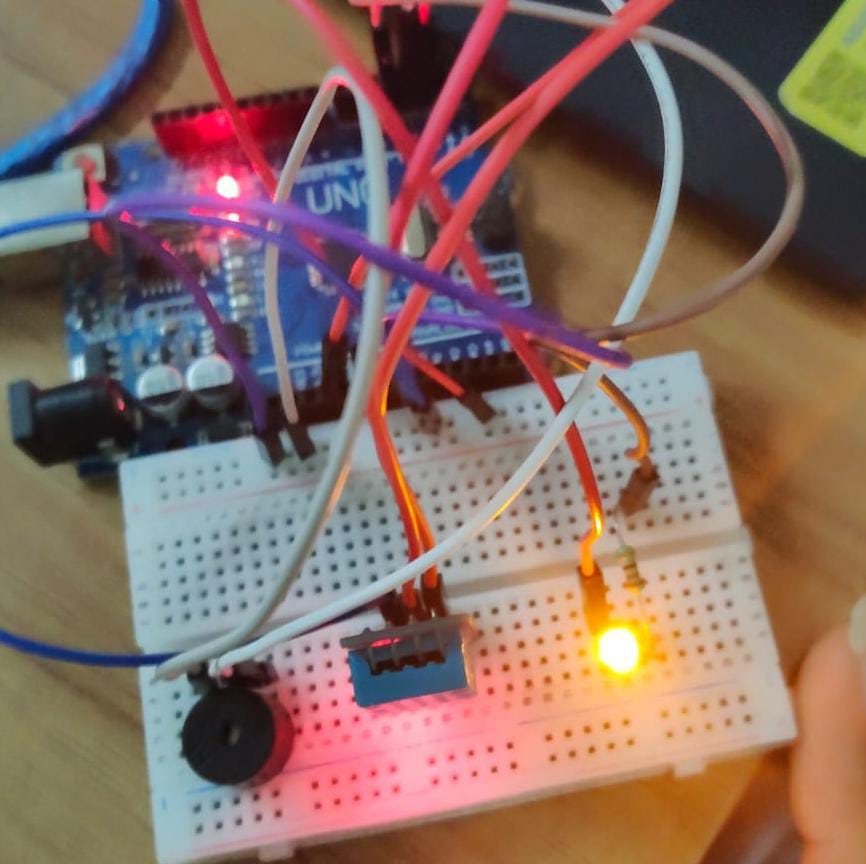

# Temperature-alert-system
# DHT11 Sensor – Temperature Alert System 🌡️
# About
A simple Arduino project using a DHT11 temperature and humidity sensor to monitor environmental conditions. When the temperature exceeds the set threshold, the buzzer beeps and the LED turns ON. When the temperature is below the threshold, the buzzer remains OFF and the LED stays OFF.
# Components Required
- Arduino Uno
- DHT11 Temperature and Humidity Sensor
- Buzzer
- LED
- Resistor
- Breadboard
- Jumper Wires
# Working
1. The DHT11 sensor measures temperature and humidity.
2. Arduino reads the temperature value.
3. The temperature is compared with a predefined threshold.
4. If the temperature is HIGH, the buzzer beeps and the LED turns ON.
5. If the temperature is LOW, the buzzer and LED turn OFF.
# Output

# Arduino Code
[View Arduino Code](./temp.ino)

# Learning Outcome
Learned how to interface a DHT11 sensor with Arduino, read temperature and humidity values, and create an alert system using an LED and buzzer.
